# BookNest — Software Design Document (SDD)

**Document version:** 1.0  
**Date:** 11 November 2026  
**Status:** MVP design baseline  
**Product type:** Personal digital library and reading tracker  
**Primary architecture:** Microservices

---

## Document purpose

This document describes the proposed design of BookNest so that the project can be implemented consistently. It defines the system architecture, service responsibilities, database schemas, domain classes, main workflows, API contracts, and interactions between components.

It is a design specification, not an implementation tutorial. The implementation language and framework are Java 21, Spring Boot, Spring Data JPA, Spring Security, and React with TypeScript. The diagrams use Mermaid so they can be edited and rendered by tools that support Mermaid, including GitHub and many Markdown editors.

## 1. Project overview

### 1.1 Problem statement

Readers often use several separate tools to discover books, remember what they want to read, track books currently in progress, and keep a record of completed books. BookNest provides one private place to organize a personal book library and track reading activity.

### 1.2 Product description

BookNest is a personal digital library and reading tracker. A user can search an external book catalog, import a selected book into BookNest's local catalog, add that book to their private library, record its reading status, update their current page, and review completed books and basic reading statistics.

BookNest stores a local copy of imported book metadata. This avoids requiring a call to the external provider every time a user opens a saved book. The local catalog is a metadata cache/catalog owned by BookNest; it is not intended to reproduce or host the full content of copyrighted books.

### 1.3 Product decisions

| Decision           | MVP choice               | Design implication                                                                                               |
| ------------------ | ------------------------ | ---------------------------------------------------------------------------------------------------------------- |
| Book catalog       | External provider        | Book Service integrates with a provider adapter and stores imported metadata locally.                            |
| Initial provider   | Google Books API adapter | Provider-specific response models must not leak into the rest of the application.                                |
| Library visibility | Private                  | All library reads and writes are scoped to the authenticated user. No public-library endpoint exists in the MVP. |
| Development scope  | MVP first                | No social network, reviews, comments, recommendations, or reading notes in the first release.                    |
| Architecture       | Microservices            | Auth, Book Catalog, and Library have separate responsibilities and data ownership.                               |
| Deployment         | Docker-based             | Infrastructure and services are containerized for repeatable local and production deployment.                    |

### 1.4 Goals

1. Allow a user to create an account and securely authenticate.
2. Allow a user to search books through an external catalog provider.
3. Allow a user to import a selected book into the BookNest catalog.
4. Allow a user to maintain a private library of imported books.
5. Allow a user to track reading status and current page.
6. Allow a user to view completed books and basic reading statistics.
7. Demonstrate practical backend engineering: service boundaries, REST APIs, relational database design, JWT authentication, external API integration, migrations, testing, containers, and deployment.

### 1.5 Out of scope for the MVP

The following features are intentionally excluded from the first release:

- Public profiles, following, and activity feeds.
- Public or shareable libraries.
- Book ratings, reviews, comments, and discussions.
- Personalized or machine-learning recommendations.
- Custom shelves and user-defined tags.
- Reading notes, highlights, and quotations.
- Reading sessions, streaks, and detailed time-based analytics.
- Native mobile applications.
- Uploading, storing, or serving full book files.
- Multiple book providers with automatic metadata reconciliation.

These may be considered after the MVP is deployed and its core user experience is stable.

---

## 2. Requirements

### 2.1 Actors

| Actor                  | Description                         | Permissions                                                                                                                                  |
| ---------------------- | ----------------------------------- | -------------------------------------------------------------------------------------------------------------------------------------------- |
| Visitor                | A person who has not authenticated. | Register and log in. Search may be configured as public; for the MVP, catalog search requires authentication to keep the API surface simple. |
| Authenticated user     | A registered BookNest user.         | Search/import catalog books; create, view, update, and delete entries in their own private library; view their own history and statistics.   |
| External book provider | Third-party catalog API.            | Supplies book metadata to the Book Service. It has no access to user accounts or personal libraries.                                         |
| Operator               | Developer or deployment operator.   | Configures secrets, runs migrations, monitors services, and manages infrastructure. There is no user-facing admin console in the MVP.        |

### 2.2 Functional requirements

| ID    | Requirement                                                                                          | Priority |
| ----- | ---------------------------------------------------------------------------------------------------- | -------- |
| FR-01 | A visitor can register using an email address, display name, and password.                           | Must     |
| FR-02 | A registered user can log in and receive an access token and refresh token.                          | Must     |
| FR-03 | A user can refresh an expired access token using a valid refresh token.                              | Must     |
| FR-04 | A user can log out and revoke the current refresh-token session.                                     | Must     |
| FR-05 | A user can retrieve their own account profile.                                                       | Must     |
| FR-06 | A user can search the external book catalog by title, author, or general query.                      | Must     |
| FR-07 | A user can import a selected external book into the local BookNest catalog.                          | Must     |
| FR-08 | Re-importing the same provider book returns the existing local book instead of creating a duplicate. | Must     |
| FR-09 | A user can add an imported book to their private library.                                            | Must     |
| FR-10 | A user can view a paginated list of their own library entries and filter by reading status.          | Must     |
| FR-11 | A user can update a library entry's reading status and current page.                                 | Must     |
| FR-12 | A user can remove a book from their private library.                                                 | Must     |
| FR-13 | A user can view their completed-book history.                                                        | Must     |
| FR-14 | A user can view basic library statistics.                                                            | Should   |
| FR-15 | All library operations are authorized against the authenticated user's ID.                           | Must     |

### 2.3 Non-functional requirements

| Area            | Requirement                                                                                                                               |
| --------------- | ----------------------------------------------------------------------------------------------------------------------------------------- |
| Security        | Passwords are hashed; access tokens are signed; refresh tokens are stored as hashes; secrets are not committed to source control.         |
| Privacy         | A user's library is private. The backend must not accept a caller-supplied user ID as authority for a library operation.                  |
| Data integrity  | Database constraints enforce uniqueness and valid reading progress in addition to application validation.                                 |
| Availability    | A failure of the external provider must not prevent a user from viewing books already imported into their library.                        |
| Performance     | Library list and history endpoints are paginated. Database indexes support user-scoped queries and status filtering.                      |
| Maintainability | Provider-specific logic is isolated behind an adapter. Services own their data and expose APIs rather than sharing tables.                |
| Observability   | Services write structured logs and include a correlation/trace ID in requests and error responses. Secrets and tokens must not be logged. |
| Portability     | Local development and deployment use environment-based configuration and Docker containers.                                               |
| Testability     | Business logic is separated from controllers and external clients so it can be unit- and integration-tested.                              |

### 2.4 Core domain rules

1. A BookNest account is identified by a UUID.
2. A catalog book is identified by a BookNest UUID. The external provider ID is retained only as a provider reference.
3. A user can have at most one active library entry for a given local catalog book in the MVP. The database enforces `UNIQUE(user_id, book_id)`.
4. A library entry can have one of four statuses: `WANT_TO_READ`, `CURRENTLY_READING`, `COMPLETED`, or `DROPPED`.
5. `current_page` must be zero or greater. If a page-count snapshot exists, `current_page` must not exceed it.
6. A library entry is private and can only be read or modified by the user whose ID is stored on that entry.
7. A book must exist in the Book Service before it can be added to a library.
8. Removing a book from a user's library does not delete the global catalog book.
9. An external provider outage must not make already-imported book metadata unavailable.
10. External IDs and user IDs are service-owned identifiers. There are no cross-service database foreign keys.

---

## 3. System architecture overview

### 3.1 Architectural style

BookNest uses a small microservices architecture with three business services:

- **Auth Service:** owns user accounts, passwords, and refresh-token sessions.
- **Book Service:** owns the global local catalog and integrates with an external book provider.
- **Library Service:** owns user-to-book library entries, statuses, progress, and reading history.

The frontend communicates through an API Gateway in the target integrated architecture. Each service owns its own database and validates the user's access token. Services communicate through REST for the synchronous MVP workflows.

### 3.2 Logical architecture diagram

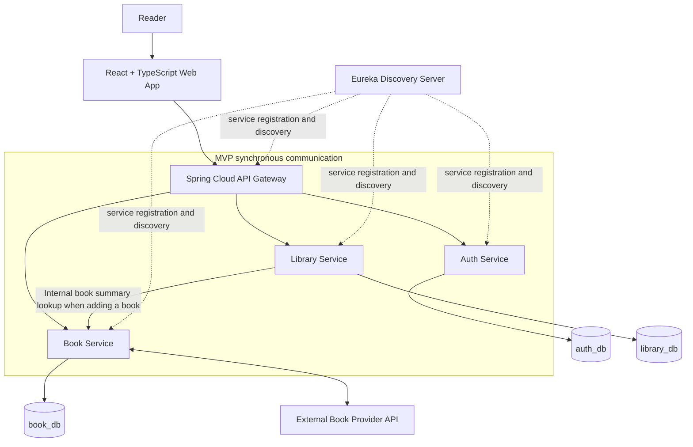

**Notes:**

- The three PostgreSQL databases are logically independent. They may run on one PostgreSQL server during local development, but each service must use its own database/schema boundary and credentials.
- The Book Service is the only service that communicates with the external provider.
- The Library Service calls a private Book Service endpoint to validate a catalog book and obtain a small metadata summary when a user adds it to their library.
- Eureka is service-discovery infrastructure, not a business service. It can be introduced when the services are integrated. During the earliest development stage, services may use fixed local URLs.
- Redis and RabbitMQ are not required for the MVP. Add them only when there is a measured caching need or a genuine asynchronous workflow.

### 3.3 Deployment view

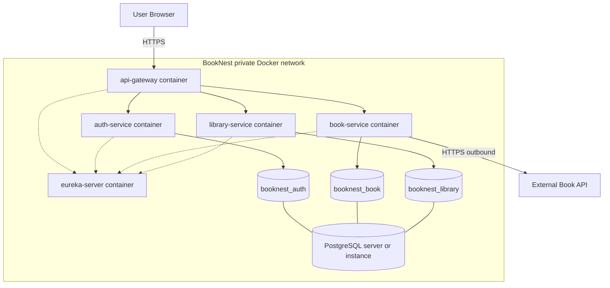

A production deployment should expose the Gateway publicly, not the individual service ports or database ports. Service-to-service endpoints and databases stay on a private network.

### 3.4 Service responsibility and ownership

| Component       | Owns                                                                                                  | Must not own                                                      |
| --------------- | ----------------------------------------------------------------------------------------------------- | ----------------------------------------------------------------- |
| Auth Service    | User account, password hash, account status, refresh-token sessions, JWT issuance.                    | Book metadata, reading progress, library entries.                 |
| Book Service    | Imported book metadata, authors, categories, provider references, provider integration.               | User passwords, user library status, reading progress.            |
| Library Service | User-book relationship, reading status, current page, date tracking, basic statistics.                | Copies of Auth or Book databases, global author/category catalog. |
| API Gateway     | External routing, TLS termination in deployment, coarse request filtering, rate limits if configured. | Business entities or persistent business data.                    |
| Eureka          | Service registration and discovery.                                                                   | User or book data.                                                |
| Frontend        | Presentation and client-side navigation/state.                                                        | Authorization decisions or trusted user identity.                 |

### 3.5 Database ownership and cross-service references

Each service owns its schema and is the only service allowed to read or write that schema.

- `auth_db.users.id` is the authoritative user ID.
- `book_db.books.id` is the authoritative catalog book ID.
- `library_db.user_books.user_id` stores an Auth Service UUID reference.
- `library_db.user_books.book_id` stores a Book Service UUID reference.

The two IDs in `library_db.user_books` are **not physical foreign keys**. The Library Service validates the book ID through the Book Service API when creating an entry. The authenticated user ID comes from the verified JWT. This avoids cross-service database coupling.

### 3.6 Communication patterns

| Interaction                      | Pattern                    | Reason                                                                           |
| -------------------------------- | -------------------------- | -------------------------------------------------------------------------------- |
| Browser to services              | HTTPS REST through Gateway | Stable public API boundary.                                                      |
| Gateway to business services     | HTTP internally            | Routing and discovery.                                                           |
| Frontend to Auth                 | REST                       | Registration and token lifecycle.                                                |
| Frontend to Book                 | REST                       | Search, import, and catalog details.                                             |
| Library to Book                  | Synchronous internal REST  | Validate a book and retrieve the page count/title/cover snapshot when adding it. |
| Business service to its database | JPA/JDBC                   | Service-owned persistence.                                                       |
| Service to service events        | Not used in MVP            | RabbitMQ would add complexity without a required MVP workflow.                   |

### 3.7 External book provider integration

The Book Service contains a provider abstraction and a provider-specific adapter. The initial adapter targets Google Books API. Provider response objects are mapped into BookNest's own normalized model.

The rest of BookNest must not depend on Google Books response classes or field names.

**Search flow:** call the provider, normalize results, and return paginated search results. Search results do not have to be permanently stored.

**Import flow:** receive the provider code and external book ID, fetch/confirm the selected provider record, then upsert it into the local catalog using `(provider, external_id)` as the unique key.

**Provider resilience:** apply connection/read timeouts, handle rate limits, avoid unlimited retries, and return a meaningful `502` or `503` when the provider cannot serve a search/import request. Local book details and existing library entries remain available from local data.

### 3.8 Authentication and authorization design

- Auth Service issues short-lived signed access JWTs.
- Recommended signing algorithm for the microservice design: **RS256**. Auth Service holds the private signing key; Gateway and resource services receive only the public key.
- A JWT `sub` claim contains the user's UUID. Include `iss`, `aud`, `iat`, `exp`, and `jti` claims. A simple `ROLE_USER` authority may be included or resolved by the service policy.
- Each downstream service validates the JWT independently. Do not trust an arbitrary `X-User-Id` header supplied by the browser.
- Refresh tokens are opaque random values. Store only a cryptographic hash in `refresh_tokens`; rotate refresh tokens on successful refresh.
- Passwords are stored as BCrypt hashes (or another appropriately configured adaptive password hash), never in plaintext.
- For a browser client, prefer an HttpOnly, Secure, SameSite refresh-token cookie in production. Protect cookie-based refresh/logout operations against CSRF. Keep access tokens short-lived and avoid storing them in local storage where practical.
- Logout revokes the refresh token/session. An already-issued access JWT remains valid until it expires unless a token-denylist mechanism is added; immediate access-token revocation is not required for the MVP.

### 3.9 Configuration and secrets

- `application.yml` contains non-secret defaults and environment-variable placeholders.
- Local secrets are supplied through an ignored `.env` file or the process environment.
- `.env.example` contains variable names and safe placeholders only.
- Production secrets are supplied through the hosting platform's secret manager or protected environment configuration.
- Database passwords, JWT private keys, provider API keys, and internal service credentials must never be committed to Git, placed in frontend code, or written to logs.

---

## 4. Database design

### 4.1 Database strategy

Use PostgreSQL with three logical databases:

| Service         | Database name      | Primary tables                                                      |
| --------------- | ------------------ | ------------------------------------------------------------------- |
| Auth Service    | `booknest_auth`    | `users`, `refresh_tokens`                                           |
| Book Service    | `booknest_book`    | `books`, `authors`, `book_authors`, `categories`, `book_categories` |
| Library Service | `booknest_library` | `user_books`                                                        |

For local development, one PostgreSQL container can host all three databases. Each service should still use a separate database user with only the permissions it needs. A separate PostgreSQL container per service is also valid but is not required to demonstrate database ownership.

Use Flyway migrations independently in each service. Do not let Hibernate generate production schema changes; use `ddl-auto: validate` (or `none` where appropriate) and let Flyway manage schema evolution.

### 4.2 Data conventions

- Primary keys: UUID, generated by the application or database consistently.
- Timestamps: PostgreSQL `TIMESTAMPTZ`; Java `Instant` or `OffsetDateTime`.
- Text: use bounded `VARCHAR` where a maximum is meaningful; use `TEXT` for long descriptions.
- Enum-like values: store as `VARCHAR` with application enums and database `CHECK` constraints. This makes adding values through migrations easier than relying on database-native enums.
- Email: normalize to lowercase and trim before persistence; enforce uniqueness on the normalized value.
- Monetary types are not needed by the MVP.
- Do not create cross-service foreign keys.

### 4.3 Auth Service schema (`booknest_auth`)

#### 4.3.1 `users`

Stores account identity and authentication data.

| Column          | PostgreSQL type | Null? | Rules / description                       |
| --------------- | --------------- | ----: | ----------------------------------------- |
| `id`            | UUID            |    No | Primary key.                              |
| `email`         | VARCHAR(255)    |    No | Normalized lowercase email; unique.       |
| `password_hash` | VARCHAR(255)    |    No | BCrypt hash; never store plaintext.       |
| `display_name`  | VARCHAR(100)    |    No | Name displayed in the application.        |
| `avatar_url`    | TEXT            |   Yes | Optional external image URL.              |
| `status`        | VARCHAR(20)     |    No | `ACTIVE` or `DISABLED`; default `ACTIVE`. |
| `created_at`    | TIMESTAMPTZ     |    No | Creation time.                            |
| `updated_at`    | TIMESTAMPTZ     |    No | Last update time.                         |

##### Users constraints and indexes

- `PRIMARY KEY (id)`.
- `UNIQUE (email)`; the application normalizes email before writing.
- `CHECK (status IN ('ACTIVE', 'DISABLED'))`.

#### 4.3.2 `refresh_tokens`

Stores refresh-token sessions for rotation and revocation.

| Column                 | PostgreSQL type | Null? | Rules / description                               |
| ---------------------- | --------------- | ----: | ------------------------------------------------- |
| `id`                   | UUID            |    No | Primary key.                                      |
| `user_id`              | UUID            |    No | FK to `users.id` within Auth Service.             |
| `token_hash`           | VARCHAR(255)    |    No | Unique hash of the opaque refresh token.          |
| `expires_at`           | TIMESTAMPTZ     |    No | Expiry time.                                      |
| `revoked_at`           | TIMESTAMPTZ     |   Yes | Set when revoked or rotated.                      |
| `replaced_by_token_id` | UUID            |   Yes | Optional self-reference to the replacement token. |
| `created_at`           | TIMESTAMPTZ     |    No | Creation time.                                    |

#### Refresh-token constraints and indexes

- `PRIMARY KEY (id)`.
- `FOREIGN KEY (user_id) REFERENCES users(id)`.
- `UNIQUE (token_hash)`.
- Optional self-FK: `replaced_by_token_id REFERENCES refresh_tokens(id)`.
- Index `(user_id, expires_at)` for session lookup/cleanup.
- A token is valid only when its hash matches, it has not expired, and `revoked_at IS NULL`.

#### 4.3.3 Auth ERD

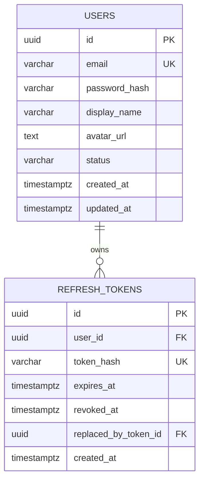

### 4.4 Book Service schema (`booknest_book`)

#### 4.4.1 `books`

Stores normalized metadata imported from an external catalog provider.

| Column            | PostgreSQL type | Null? | Rules / description                                               |
| ----------------- | --------------- | ----: | ----------------------------------------------------------------- |
| `id`              | UUID            |    No | BookNest primary key.                                             |
| `provider`        | VARCHAR(30)     |    No | Provider code, e.g. `GOOGLE_BOOKS`.                               |
| `external_id`     | VARCHAR(255)    |    No | Provider's stable book/volume ID.                                 |
| `title`           | VARCHAR(500)    |    No | Normalized title.                                                 |
| `subtitle`        | VARCHAR(500)    |   Yes | Optional subtitle.                                                |
| `description`     | TEXT            |   Yes | Provider-supplied description.                                    |
| `isbn_10`         | VARCHAR(10)     |   Yes | ISBN-10 when available.                                           |
| `isbn_13`         | VARCHAR(13)     |   Yes | ISBN-13 when available.                                           |
| `publisher`       | VARCHAR(255)    |   Yes | Publisher when available.                                         |
| `published_date`  | VARCHAR(40)     |   Yes | Preserve provider formats such as year, year-month, or full date. |
| `page_count`      | INTEGER         |   Yes | Must be positive when present.                                    |
| `language_code`   | VARCHAR(10)     |   Yes | Language code when available.                                     |
| `cover_image_url` | TEXT            |   Yes | External cover image URL.                                         |
| `info_url`        | TEXT            |   Yes | Provider information/preview URL.                                 |
| `created_at`      | TIMESTAMPTZ     |    No | First import time.                                                |
| `updated_at`      | TIMESTAMPTZ     |    No | Last metadata update time.                                        |
| `last_synced_at`  | TIMESTAMPTZ     |   Yes | Last successful provider refresh.                                 |

#### Book constraints and indexes

- `PRIMARY KEY (id)`.
- `UNIQUE (provider, external_id)` prevents duplicate imports from the same provider.
- `CHECK (page_count IS NULL OR page_count > 0)`.
- Index on `title` for search. Consider a PostgreSQL trigram/full-text index only if ordinary search becomes too slow.
- ISBN values are indexed if needed but are not globally unique: editions and provider records can legitimately share or omit identifiers.

#### 4.4.2 `authors`

| Column | PostgreSQL type | Null? | Rules / description     |
| ------ | --------------- | ----: | ----------------------- |
| `id`   | UUID            |    No | Primary key.            |
| `name` | VARCHAR(255)    |    No | Normalized author name. |

#### 4.4.3 `book_authors`

Join table for the many-to-many relationship between books and authors.

| Column          | PostgreSQL type | Null? | Rules / description                              |
| --------------- | --------------- | ----: | ------------------------------------------------ |
| `book_id`       | UUID            |    No | FK to `books.id`.                                |
| `author_id`     | UUID            |    No | FK to `authors.id`.                              |
| `display_order` | INTEGER         |    No | Preserves provider author order; starts at zero. |

**Relationship constraints:** composite primary key `(book_id, author_id)`; foreign keys to `books` and `authors`; index on `author_id`; non-negative `display_order`.

#### 4.4.4 `categories`

| Column | PostgreSQL type | Null? | Rules / description                       |
| ------ | --------------- | ----: | ----------------------------------------- |
| `id`   | UUID            |    No | Primary key.                              |
| `name` | VARCHAR(100)    |    No | Normalized category/subject name; unique. |

#### 4.4.5 `book_categories`

| Column        | PostgreSQL type | Null? | Rules / description    |
| ------------- | --------------- | ----: | ---------------------- |
| `book_id`     | UUID            |    No | FK to `books.id`.      |
| `category_id` | UUID            |    No | FK to `categories.id`. |

**Relationship constraints:** composite primary key `(book_id, category_id)` and foreign keys to `books` and `categories`.

#### 4.4.6 Book Catalog ERD

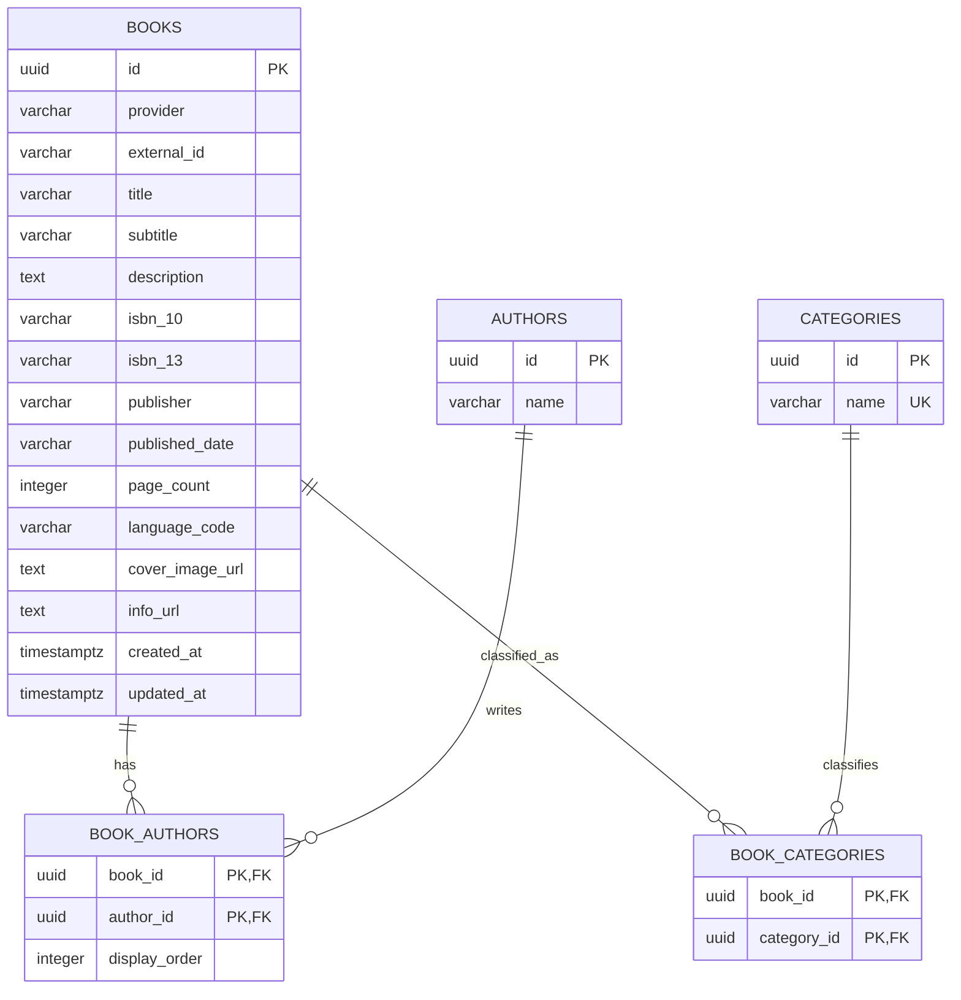

**Import behavior:** within one Book Service transaction, create/update the `books` record and reconcile its author/category relationships. Normalize author/category names consistently. Provider-specific author/category identifiers are not assumed to be globally stable unless the chosen provider adapter explicitly supplies and the design later stores them.

### 4.5 Library Service schema (`booknest_library`)

#### 4.5.1 `user_books`

Represents one user's relationship with one imported catalog book. This is the central table of the Library Service.

| Column                | PostgreSQL type | Null? | Rules / description                                                                        |
| --------------------- | --------------- | ----: | ------------------------------------------------------------------------------------------ |
| `id`                  | UUID            |    No | Primary key for the library entry.                                                         |
| `user_id`             | UUID            |    No | Auth Service user ID; external reference, no cross-service FK.                             |
| `book_id`             | UUID            |    No | Book Service catalog ID; external reference, no cross-service FK.                          |
| `book_title_snapshot` | VARCHAR(500)    |    No | Title captured when added; supports library listing if catalog is temporarily unavailable. |
| `cover_url_snapshot`  | TEXT            |   Yes | Cover URL captured when added.                                                             |
| `status`              | VARCHAR(30)     |    No | `WANT_TO_READ`, `CURRENTLY_READING`, `COMPLETED`, or `DROPPED`.                            |
| `current_page`        | INTEGER         |    No | Defaults to zero; non-negative.                                                            |
| `page_count_snapshot` | INTEGER         |   Yes | Catalog page count captured at add time; positive when present.                            |
| `started_at`          | TIMESTAMPTZ     |   Yes | First time the user starts reading this entry.                                             |
| `completed_at`        | TIMESTAMPTZ     |   Yes | Time the user marked it completed.                                                         |
| `added_at`            | TIMESTAMPTZ     |    No | Time added to the personal library.                                                        |
| `updated_at`          | TIMESTAMPTZ     |    No | Last change time.                                                                          |

##### Library-entry constraints and indexes

- `PRIMARY KEY (id)`.
- `UNIQUE (user_id, book_id)` prevents duplicate entries for the same user and catalog book.
- `CHECK (status IN ('WANT_TO_READ', 'CURRENTLY_READING', 'COMPLETED', 'DROPPED'))`.
- `CHECK (current_page >= 0)`.
- `CHECK (page_count_snapshot IS NULL OR page_count_snapshot > 0)`.
- `CHECK (page_count_snapshot IS NULL OR current_page <= page_count_snapshot)`.
- Index `(user_id, added_at DESC)` for the default library view.
- Index `(user_id, status, updated_at DESC)` for status filters and summaries.
- Index `(user_id, completed_at DESC)` for reading history.
- Consider a separate index on `book_id` only if operational queries require it.

**Why store snapshots?** The title, cover URL, and page count snapshot allow the Library Service to render existing library entries without calling the Book Service for every row. These are display/progress snapshots, not an alternative catalog. A later metadata synchronization mechanism may refresh them. The Library Service remains the owner of progress and status.

##### MVP status behavior

| Status              | Meaning                           | Date behavior                                                                                                                          |
| ------------------- | --------------------------------- | -------------------------------------------------------------------------------------------------------------------------------------- |
| `WANT_TO_READ`      | User plans to read the book.      | `started_at` and `completed_at` are null when newly created.                                                                           |
| `CURRENTLY_READING` | User is actively reading.         | Set `started_at` on the first transition into this status if it is null.                                                               |
| `COMPLETED`         | User marked the book as finished. | Set `completed_at` to the current time. If a page count snapshot exists, set `current_page` to that page count when marking completed. |
| `DROPPED`           | User stopped reading the book.    | Keep the last recorded page. Clear `completed_at` if moving away from completed.                                                       |

For the MVP, status transitions are flexible, but all changes must preserve date and progress consistency. Moving an entry back to `WANT_TO_READ` resets progress to zero and clears the reading dates. Re-reading and multiple completion attempts are not separately recorded in the MVP.

#### 4.5.2 Library ERD

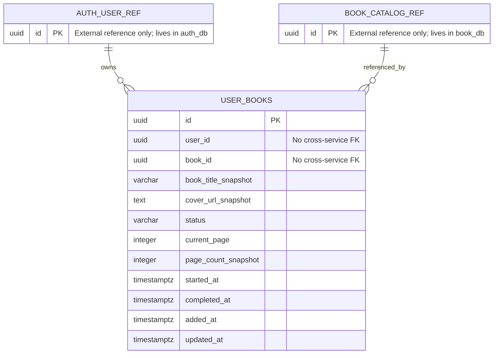

`AUTH_USER_REF` and `BOOK_CATALOG_REF` in this diagram are conceptual references, not actual tables in `booknest_library`.

### 4.6 Cross-service data flow when adding a book

1. Frontend imports a book through the Book Service and receives the local `bookId`.
2. Frontend sends `bookId` and the desired initial status to the Library Service.
3. Library Service gets `userId` from the validated JWT subject, not from the request body.
4. Library Service calls a private Book Service endpoint to validate `bookId` and obtain `title`, `coverImageUrl`, and `pageCount`.
5. Library Service creates `user_books` with the returned metadata snapshots.
6. The unique constraint prevents duplicate user/book entries.

The internal call must be authenticated and must not be exposed as a public browser endpoint. For a simple MVP, use a protected internal service credential supplied through deployment secrets; a mature deployment can move to OAuth2 client credentials or mTLS.

### 4.7 Migration strategy

Each service maintains its own migration history and migration files.

```text
backend/
├── auth-service/src/main/resources/db/migration/
│   ├── V1__create_users_table.sql
│   └── V2__create_refresh_tokens_table.sql
├── book-service/src/main/resources/db/migration/
│   ├── V1__create_books_table.sql
│   ├── V2__create_authors_and_book_authors.sql
│   └── V3__create_categories_and_book_categories.sql
└── library-service/src/main/resources/db/migration/
    └── V1__create_user_books_table.sql
```

Migration files are immutable after they have been applied in a shared or deployed environment. Schema changes are introduced with new versioned migration files.

---

## 5. Class design

The class diagrams below describe the intended domain and application-layer design. They are conceptual diagrams; exact class names and package names may be adjusted during implementation without changing service ownership.

### 5.1 Auth Service class diagram

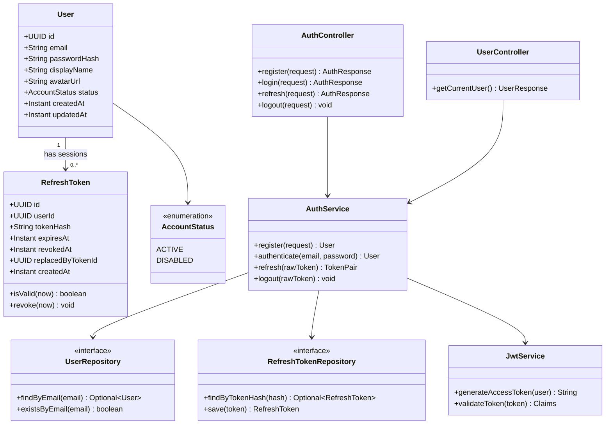

**Design responsibilities:**

- Controllers validate HTTP input and delegate to application services.
- `AuthService` owns registration, credential validation, refresh rotation, and logout behavior.
- `JwtService` signs and validates token claims; private-key access remains inside Auth Service.
- Repositories persist only Auth Service entities.
- Password hashing is delegated to Spring Security's `PasswordEncoder` rather than implemented manually.

### 5.2 Book Service class diagram

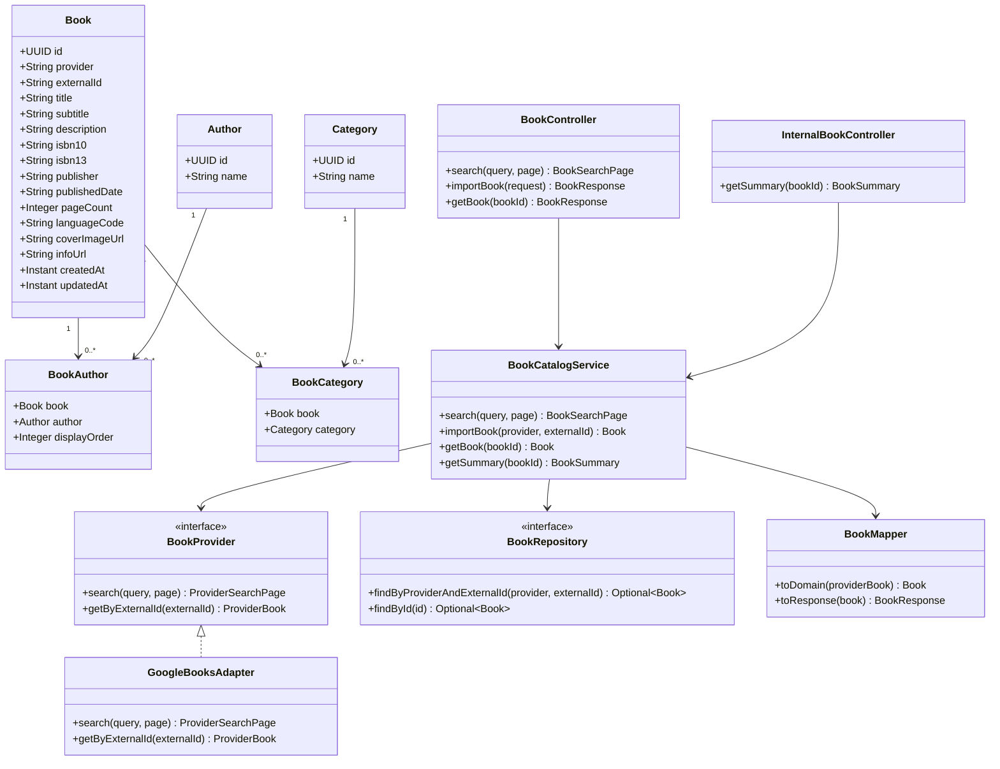

**Design responsibilities:**

- `BookProvider` is a provider-neutral port/interface.
- `GoogleBooksAdapter` handles HTTP requests, provider error mapping, and mapping provider response data into a provider-neutral DTO.
- `BookCatalogService` implements search, idempotent import/upsert, and local retrieval.
- `BookMapper` maps normalized provider data to domain entities and API response DTOs.
- `InternalBookController` exposes only the minimal summary needed by the Library Service and is protected as an internal endpoint.

### 5.3 Library Service class diagram

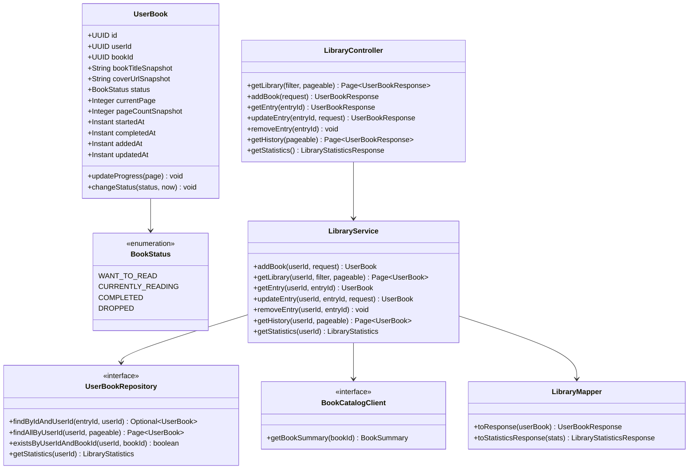

**Critical authorization rule:** repository methods and service methods must include `userId` in their query criteria. A method that fetches a library entry by `entryId` alone is not sufficient for a user-facing operation.

### 5.4 Suggested package organization

A practical package structure for each service is:

```text
com.azure.booknest.<service>
├── config
├── controller
│   └── internal                 # Book Service internal endpoints, if applicable
├── dto
│   ├── request
│   └── response
├── entity                       # or domain, if using a richer domain model
├── enums
├── exception
├── mapper
├── repository
├── security                     # resource-server/JWT configuration as applicable
├── service
│   └── impl                     # optional implementation subpackage
└── client                       # external or inter-service HTTP clients
```

Keep provider API DTOs separate from BookNest API DTOs. Do not return JPA entities directly from controllers.

---

## 6. Activity diagrams and workflows

### 6.1 Account registration and login activity

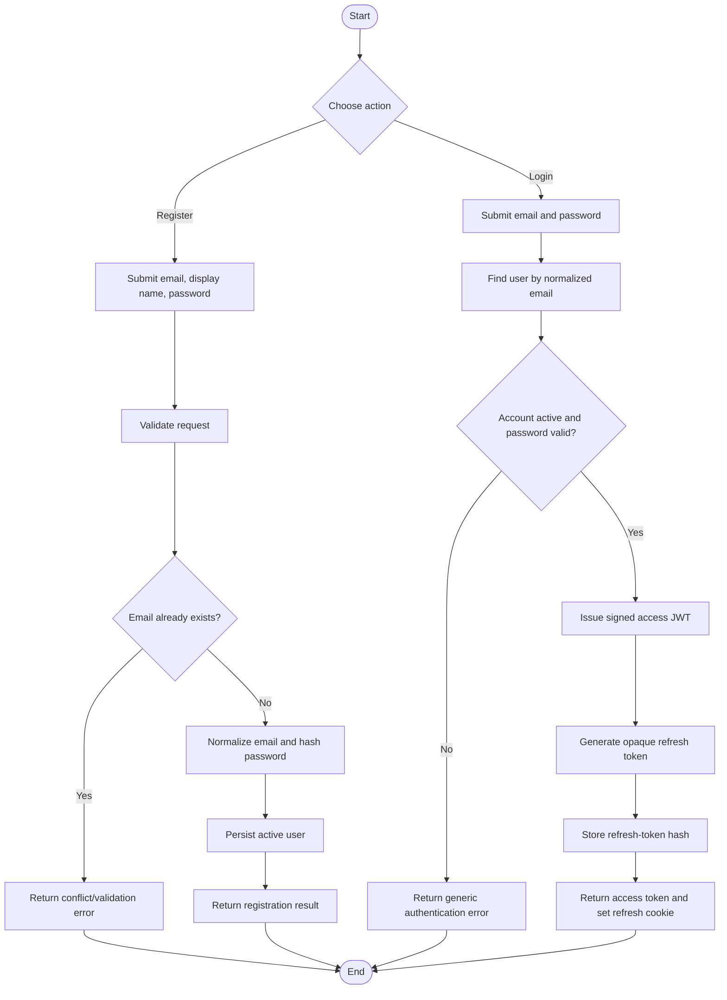

### 6.2 Search, import, and add-to-library activity

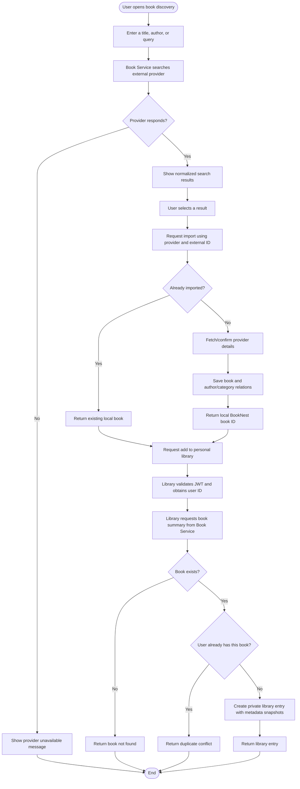

### 6.3 Update reading progress and status activity

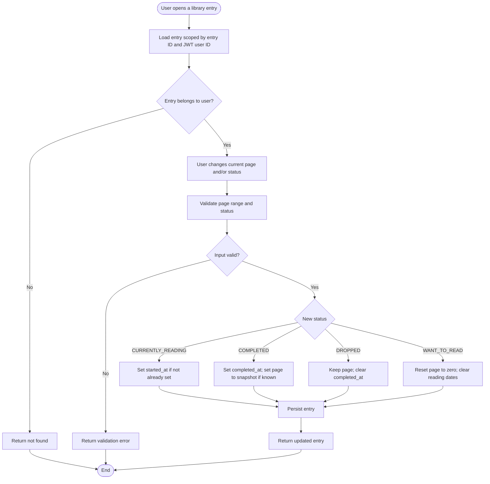

### 6.4 View library, history, and statistics activity

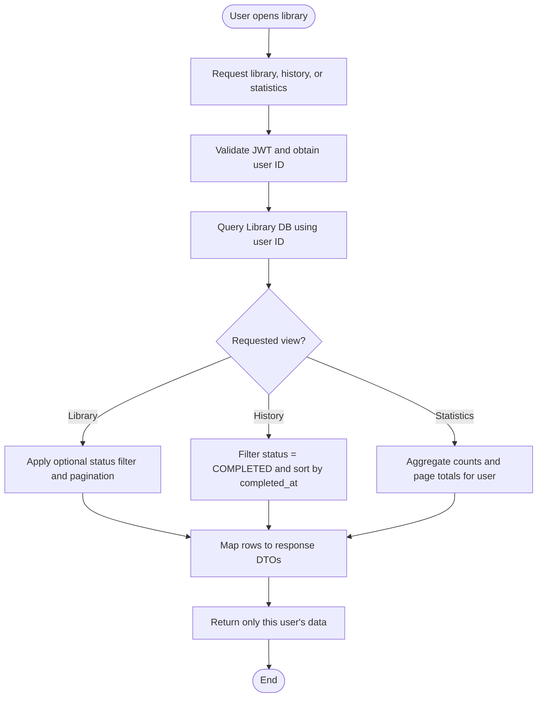

---

## 7. Sequence diagrams

Each diagram illustrates one principal feature and the expected service interactions. Error paths are included where they materially affect behavior.

### 7.1 User registration

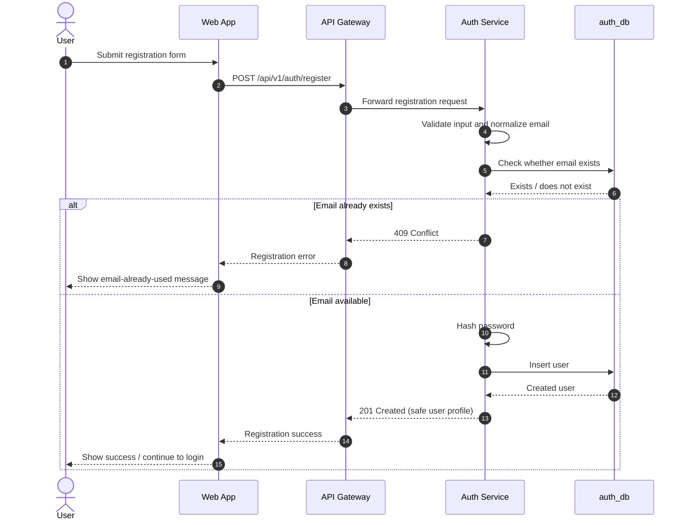

### 7.2 User login

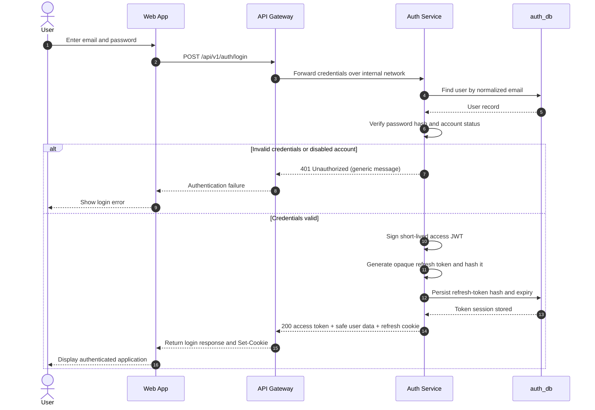

### 7.3 Refresh access token

```mermaid
sequenceDiagram
    autonumber
    participant FE as Web App
    participant GW as API Gateway
    participant AUTH as Auth Service
    participant DB as auth_db

    FE->>GW: POST /api/v1/auth/refresh (HttpOnly cookie)
    GW->>AUTH: Forward refresh request and cookie
    AUTH->>AUTH: Hash supplied refresh token
    AUTH->>DB: Find matching token hash
    DB-->>AUTH: Token session and user
    AUTH->>AUTH: Check expiry, revocation, and user status
    alt Token invalid or expired
        AUTH-->>GW: 401 Unauthorized; clear cookie
        GW-->>FE: Refresh failed
    else Token valid
        AUTH->>AUTH: Revoke old token and generate replacement
        AUTH->>AUTH: Sign new access JWT and hash new refresh token
        AUTH->>DB: Persist replacement and link rotation
        DB-->>AUTH: Rotation stored
        AUTH-->>GW: 200 new access token + replacement cookie
        GW-->>FE: Return refreshed session
    end
```

### 7.4 Logout

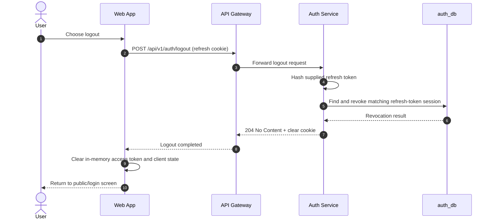

### 7.5 Search books in the external catalog

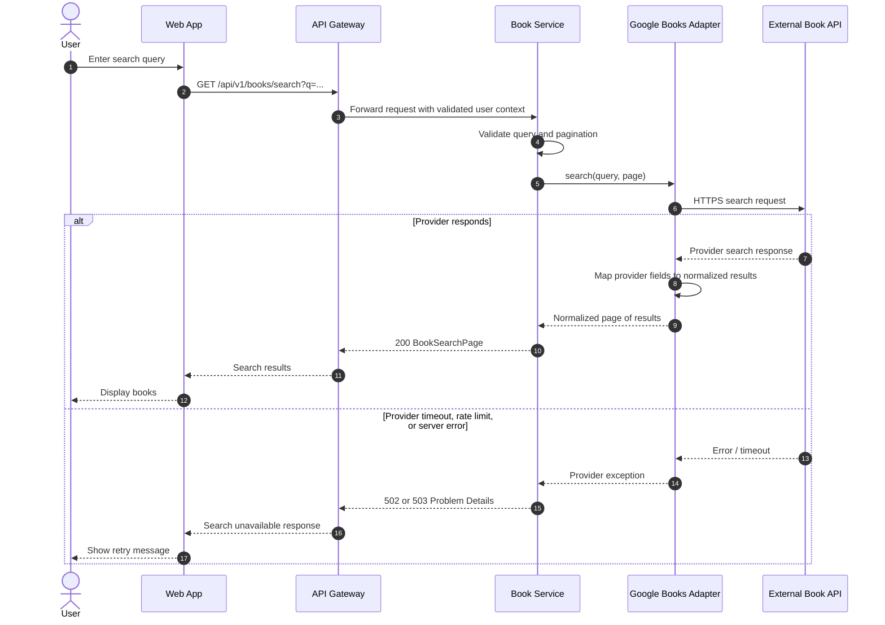

Search is not required to persist every result. The user must select a result and import it before it receives a BookNest `bookId`.

### 7.6 Import a selected catalog book

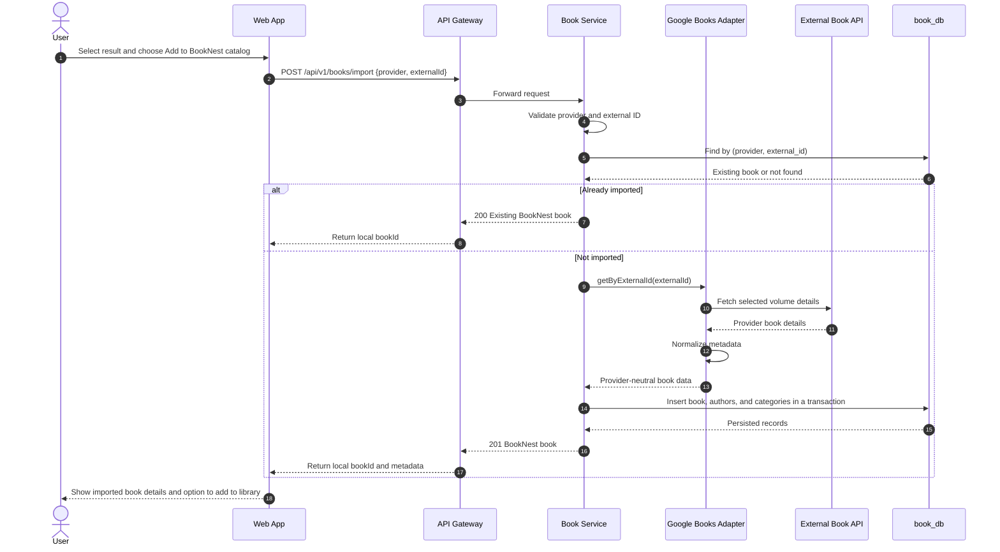

The unique constraint on `(provider, external_id)` is the final protection against duplicate imports under concurrent requests. Handle a uniqueness race by re-reading and returning the existing record.

### 7.7 Add a book to the private library

```mermaid
sequenceDiagram
    autonumber
    actor User
    participant FE as Web App
    participant GW as API Gateway
    participant LIB as Library Service
    participant BOOK as Book Service internal API
    participant DB as library_db

    User->>FE: Choose Add to my library
    FE->>GW: POST /api/v1/me/library {bookId, status}
    GW->>LIB: Forward request and access JWT
    LIB->>LIB: Validate JWT; obtain userId from sub claim
    LIB->>BOOK: GET /internal/books/{bookId}/summary (service-authenticated)
    alt Catalog book does not exist
        BOOK-->>LIB: 404 Not Found
        LIB-->>GW: 404 Book not found
        GW-->>FE: Display error
    else Catalog book exists
        BOOK-->>LIB: BookSummary {id, title, coverUrl, pageCount}
        LIB->>DB: Check/insert user_books for (userId, bookId)
        alt Duplicate library entry
            DB-->>LIB: Unique constraint conflict
            LIB-->>GW: 409 Already in library
            GW-->>FE: Display duplicate message
        else New library entry
            DB-->>LIB: Created entry
            LIB-->>GW: 201 UserBookResponse
            GW-->>FE: Return created library entry
            FE-->>User: Show book in private library
        end
    end
```

The request body must not include an authoritative `userId`. A client-supplied user ID is ignored or rejected.

### 7.8 View the private library

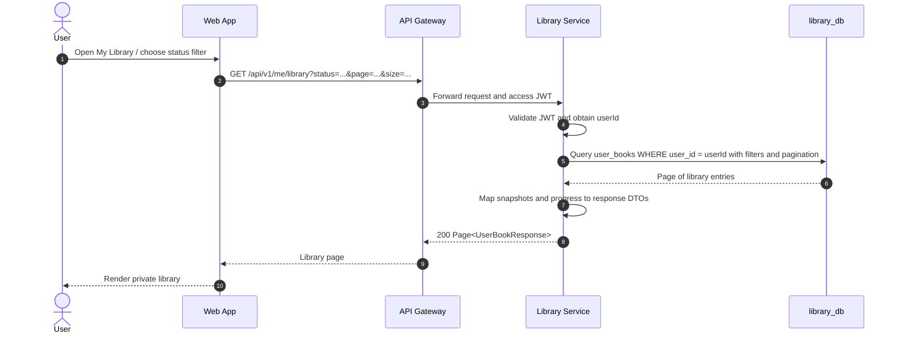

A library list request does not call the external provider or Book Service. It uses locally stored snapshots so existing library data remains available during a provider outage.

### 7.9 Update reading progress or status

```mermaid
sequenceDiagram
    autonumber
    actor User
    participant FE as Web App
    participant GW as API Gateway
    participant LIB as Library Service
    participant DB as library_db

    User->>FE: Update current page and/or reading status
    FE->>GW: PATCH /api/v1/me/library/{entryId}
    GW->>LIB: Forward request and access JWT
    LIB->>LIB: Validate JWT and obtain userId
    LIB->>DB: Find entry WHERE id = entryId AND user_id = userId
    alt Entry missing or belongs to another user
        DB-->>LIB: No matching row
        LIB-->>GW: 404 Not Found
        GW-->>FE: Entry not found
    else Entry belongs to user
        DB-->>LIB: Existing entry
        LIB->>LIB: Validate page and apply status/date rules
        alt Invalid page or status
            LIB-->>GW: 400/422 validation response
            GW-->>FE: Show validation error
        else Valid update
            LIB->>DB: Update progress/status/timestamps
            DB-->>LIB: Updated entry
            LIB-->>GW: 200 UserBookResponse
            GW-->>FE: Updated entry
            FE-->>User: Refresh progress display
        end
    end
```

### 7.10 Remove a book from the private library

```mermaid
sequenceDiagram
    autonumber
    actor User
    participant FE as Web App
    participant GW as API Gateway
    participant LIB as Library Service
    participant DB as library_db

    User->>FE: Remove book from library
    FE->>GW: DELETE /api/v1/me/library/{entryId}
    GW->>LIB: Forward request and access JWT
    LIB->>LIB: Validate JWT and obtain userId
    LIB->>DB: DELETE/locate entry WHERE id = entryId AND user_id = userId
    alt No matching entry
        DB-->>LIB: No row found
        LIB-->>GW: 404 Not Found
        GW-->>FE: Entry not found
    else Entry belongs to user
        DB-->>LIB: Entry deleted
        LIB-->>GW: 204 No Content
        GW-->>FE: Removal completed
        FE-->>User: Remove item from displayed library
    end
```

Deleting a `user_books` row does not delete the corresponding `books` row in the Book Service.

### 7.11 View completed-book history

```mermaid
sequenceDiagram
    autonumber
    actor User
    participant FE as Web App
    participant GW as API Gateway
    participant LIB as Library Service
    participant DB as library_db

    User->>FE: Open Reading History
    FE->>GW: GET /api/v1/me/library/history?page=...&size=...
    GW->>LIB: Forward request and access JWT
    LIB->>LIB: Validate JWT and obtain userId
    LIB->>DB: Query user_books WHERE user_id = userId AND status = COMPLETED ORDER BY completed_at DESC
    DB-->>LIB: Paginated completed entries
    LIB-->>GW: 200 Page<UserBookResponse>
    GW-->>FE: Completed history
    FE-->>User: Display completed books and completion dates
```

### 7.12 View reading statistics

```mermaid
sequenceDiagram
    autonumber
    actor User
    participant FE as Web App
    participant GW as API Gateway
    participant LIB as Library Service
    participant DB as library_db

    User->>FE: Open Reading Statistics
    FE->>GW: GET /api/v1/me/library/statistics
    GW->>LIB: Forward request and access JWT
    LIB->>LIB: Validate JWT and obtain userId
    LIB->>DB: Aggregate counts and SUM(current_page) for userId
    DB-->>LIB: Counts and page total
    LIB->>LIB: Build statistics response
    LIB-->>GW: 200 LibraryStatisticsResponse
    GW-->>FE: Statistics
    FE-->>User: Display reading summary
```

MVP statistics are a snapshot of the current library state, not a historical analytics ledger. `pagesReadTotal` is calculated as the sum of `current_page` across the user's library entries; it is an approximation and does not count multiple rereads separately.

---

## 8. API design

### 8.1 API conventions

- Base path: `/api/v1`.
- Format: JSON over HTTPS.
- Use UUID strings in API payloads.
- Use ISO-8601 timestamps with timezone information.
- Use pagination for collection endpoints (`page`, `size`, and an optional sort parameter).
- Use `PATCH` for partial updates and `DELETE` to remove a private library entry.
- Do not expose JPA entities directly.
- All authenticated endpoints require `Authorization: Bearer <access-token>`.
- The refresh token should be transmitted in a secure cookie in production rather than returned in a JSON field.

### 8.2 Auth Service public endpoints

| Method | Endpoint                | Authentication                         | Purpose                                            |
| ------ | ----------------------- | -------------------------------------- | -------------------------------------------------- |
| POST   | `/api/v1/auth/register` | Public                                 | Create an account.                                 |
| POST   | `/api/v1/auth/login`    | Public                                 | Authenticate and issue tokens.                     |
| POST   | `/api/v1/auth/refresh`  | Refresh cookie                         | Rotate refresh session and issue new access token. |
| POST   | `/api/v1/auth/logout`   | Refresh cookie / authenticated session | Revoke refresh session and clear cookie.           |
| GET    | `/api/v1/users/me`      | Access JWT                             | Return current user's safe profile.                |

#### Registration request example

```json
{
  "email": "reader@example.com",
  "displayName": "Book Lover",
  "password": "a-strong-password"
}
```

#### Safe user response example

```json
{
  "id": "8d268e0f-3ec0-4d03-8751-38ec8b1303c0",
  "email": "reader@example.com",
  "displayName": "Book Lover",
  "avatarUrl": null
}
```

Never include `passwordHash`, refresh token hashes, or internal security data in a user response.

### 8.3 Book Service public endpoints

| Method | Endpoint                                                 | Authentication | Purpose                                            |
| ------ | -------------------------------------------------------- | -------------- | -------------------------------------------------- |
| GET    | `/api/v1/books/search?q={query}&page={page}&size={size}` | Access JWT     | Search external catalog.                           |
| POST   | `/api/v1/books/import`                                   | Access JWT     | Import a provider result and return local book ID. |
| GET    | `/api/v1/books/{bookId}`                                 | Access JWT     | Get locally imported book details.                 |

#### Import request example

```json
{
  "provider": "GOOGLE_BOOKS",
  "externalId": "provider-volume-id"
}
```

The client supplies a provider code and external ID, not a full book object to persist. The Book Service fetches/validates metadata itself so clients cannot inject arbitrary provider data into the catalog.

### 8.4 Book Service internal endpoint

| Method | Endpoint                           | Authentication                | Purpose                                                                        |
| ------ | ---------------------------------- | ----------------------------- | ------------------------------------------------------------------------------ |
| GET    | `/internal/books/{bookId}/summary` | Service-to-service credential | Return the small set of catalog fields required when creating a library entry. |

Example response:

```json
{
  "id": "a4c3b94b-d6c3-4aa5-8d8d-b0b90e47bf8a",
  "title": "Clean Code",
  "coverImageUrl": "https://example.invalid/cover.jpg",
  "pageCount": 464
}
```

The endpoint must not be routed by the public Gateway. In production, protect it with a dedicated service identity, OAuth2 client credentials, or mTLS. Do not rely only on an obscure URL path for security.

### 8.5 Library Service public endpoints

| Method | Endpoint                        | Authentication | Purpose                                             |
| ------ | ------------------------------- | -------------- | --------------------------------------------------- |
| GET    | `/api/v1/me/library`            | Access JWT     | List the current user's private library.            |
| POST   | `/api/v1/me/library`            | Access JWT     | Add an imported book to the current user's library. |
| GET    | `/api/v1/me/library/{entryId}`  | Access JWT     | Get one entry owned by the current user.            |
| PATCH  | `/api/v1/me/library/{entryId}`  | Access JWT     | Update current page and/or status.                  |
| DELETE | `/api/v1/me/library/{entryId}`  | Access JWT     | Remove an entry owned by the current user.          |
| GET    | `/api/v1/me/library/history`    | Access JWT     | List completed entries.                             |
| GET    | `/api/v1/me/library/statistics` | Access JWT     | Return basic statistics for the current user.       |

#### Add-to-library request example

```json
{
  "bookId": "a4c3b94b-d6c3-4aa5-8d8d-b0b90e47bf8a",
  "status": "WANT_TO_READ"
}
```

#### Progress/status patch example

```json
{
  "currentPage": 120,
  "status": "CURRENTLY_READING"
}
```

Omitted PATCH properties remain unchanged. Explicit null behavior should be defined per field; for MVP, clients should omit fields they do not intend to change. The backend must reject negative pages and pages greater than the page-count snapshot when that snapshot is known.

### 8.6 Example library response

```json
{
  "id": "f25bc00d-1383-4b5a-9d1c-5c859b588d2a",
  "bookId": "a4c3b94b-d6c3-4aa5-8d8d-b0b90e47bf8a",
  "bookTitle": "Clean Code",
  "coverUrl": "https://example.invalid/cover.jpg",
  "status": "CURRENTLY_READING",
  "currentPage": 120,
  "pageCount": 464,
  "progressPercent": 25.86,
  "startedAt": "2026-11-10T10:00:00Z",
  "completedAt": null,
  "addedAt": "2026-11-09T14:30:00Z",
  "updatedAt": "2026-11-11T01:20:00Z"
}
```

`progressPercent` is calculated by the Library Service. If `pageCount` is unknown, return `null` for the percentage rather than dividing by zero or inventing a value.

### 8.7 Statistics response

```json
{
  "totalBooks": 12,
  "wantToReadCount": 5,
  "currentlyReadingCount": 2,
  "completedCount": 4,
  "droppedCount": 1,
  "pagesReadTotal": 1380
}
```

### 8.8 Error response convention

Use a consistent Problem Details-style response. Example:

```json
{
  "type": "about:blank",
  "title": "Conflict",
  "status": 409,
  "detail": "This book is already in your library.",
  "instance": "/api/v1/me/library",
  "code": "LIBRARY_BOOK_ALREADY_EXISTS",
  "traceId": "7e9a8a3b2d1c"
}
```

Common status codes:

| HTTP status | Meaning                                              | Example                                                              |
| ----------- | ---------------------------------------------------- | -------------------------------------------------------------------- |
| 400         | Malformed or invalid request                         | Missing query, invalid page number, invalid status.                  |
| 401         | Missing/invalid authentication                       | Invalid access or refresh token.                                     |
| 403         | Authenticated but not permitted                      | A disabled account or disallowed operation.                          |
| 404         | Resource not found in the caller's scope             | Entry does not exist or is not owned by the current user.            |
| 409         | State conflict                                       | Duplicate email, duplicate library entry, or duplicate import race.  |
| 422         | Semantically invalid state transition, if adopted    | Invalid progress/status combination.                                 |
| 429         | Rate limit exceeded                                  | Login or provider search rate limit.                                 |
| 502         | Upstream provider returned an invalid/error response | External catalog failure.                                            |
| 503         | Required dependency unavailable                      | Book Service unavailable while validating an add-to-library request. |

For privacy, a library entry owned by another user should generally be treated as not found (`404`) rather than revealing that it exists.

---

## 9. Security and privacy controls

### 9.1 Authentication controls

- Hash passwords with BCrypt using an appropriate work factor.
- Enforce password length and reasonable complexity rules without imposing brittle composition rules.
- Normalize email before lookup and persistence.
- Use generic login errors so the response does not reveal whether an email exists.
- Rate-limit registration, login, and refresh endpoints at the edge or Auth Service.
- Keep access tokens short-lived; rotate refresh tokens.
- Hash refresh tokens before database storage.
- Sign JWTs with a private key held only by Auth Service.
- Validate token signature, issuer, audience, expiry, and required claims in each resource service.

### 9.2 Private library authorization

Every Library Service request must derive `userId` from the verified JWT subject. For every query involving a library entry, include both the entry ID (when applicable) and the authenticated user ID.

Correct query intent:

```text
find entry where entry.id = requestedEntryId
              and entry.userId = authenticatedUserId
```

Do not implement a user-facing repository call that retrieves an entry only by its UUID and then assumes the caller is allowed to access it.

### 9.3 Secrets and network boundaries

- Never commit `.env`, private JWT keys, database passwords, or provider keys.
- Commit `.env.example` with placeholders only.
- Do not expose PostgreSQL, Eureka, or internal service endpoints publicly.
- In production, use HTTPS from browser to Gateway and a private network for internal calls.
- Avoid logging Authorization headers, passwords, refresh tokens, or provider credentials.

### 9.4 External metadata and copyright

BookNest stores metadata and cover-image URLs supplied by the provider. It does not download or host full copyrighted book content in the MVP. Respect the selected provider's API terms, attribution requirements, quotas, and permitted image-link usage.

---

## 10. Validation and business rules

### 10.1 Registration

- Email is required, normalized, and validly formatted.
- Email maximum length is 255 characters.
- Display name is required and has a maximum length of 100 characters.
- Password must meet the application's minimum length policy.
- Email uniqueness is enforced in the database as well as checked in the service.

### 10.2 Book import

- Provider must be a supported provider code.
- External ID must be non-empty and within the configured maximum length.
- The Book Service fetches provider metadata; it does not trust client-supplied title/author/page-count fields.
- A provider book is unique by `(provider, external_id)`.
- Missing metadata fields remain null; do not invent a page count, publisher, or publication date.

### 10.3 Library operations

- `bookId` is required to add a book.
- The catalog book must exist.
- Initial status defaults to `WANT_TO_READ` when omitted.
- A duplicate `(userId, bookId)` produces a conflict response.
- `currentPage` cannot be negative.
- If `pageCountSnapshot` is known, `currentPage` cannot exceed it.
- All list, get, update, delete, history, and statistics operations are scoped by `userId`.
- A user cannot change another user's entry by changing a UUID in the URL or request payload.

---

## 11. Error handling, resilience, and observability

### 11.1 Error handling

Each service should have centralized exception handling and a consistent response format. Do not expose stack traces, SQL statements, internal hostnames, or secrets in API responses.

Map expected errors explicitly:

- Validation failure → `400` (or `422` if the API consistently uses it for semantic validation).
- Missing resource → `404`.
- Duplicate business resource → `409`.
- Invalid authentication → `401`.
- Upstream provider failure → `502`/`503`.

### 11.2 Resilience

- Configure connection and read timeouts for external and inter-service HTTP clients.
- Limit retries; use retries only for transient failures and safe/idempotent operations.
- Do not blindly retry a non-idempotent POST unless an idempotency mechanism or unique constraint makes the operation safe.
- Use unique database constraints as the final defense against duplicate imports and duplicate library entries.
- Existing catalog and library reads should use local data and should not depend on the external provider.

### 11.3 Logging and monitoring

- Use structured logs with timestamp, service name, severity, trace/correlation ID, and operation.
- Do not log passwords, Authorization headers, refresh-token values, or secrets.
- Record provider latency, provider error rate, authentication failures, database errors, and request latency.
- Add health/readiness endpoints for orchestration. Readiness should verify required dependencies without exposing credentials or detailed configuration.

---

## 12. Testing strategy

### 12.1 Auth Service

- Registration succeeds with valid input.
- Duplicate email is rejected.
- Password is stored as a hash and never returned.
- Login rejects incorrect credentials and disabled users.
- Access JWT contains the expected subject, issuer, audience, and expiry.
- Refresh token is stored only as a hash.
- Refresh rotates the old token and rejects reuse of a revoked token.
- Logout revokes the active refresh token.

### 12.2 Book Service

- Provider adapter maps valid provider responses into normalized BookNest data.
- Missing optional fields are handled.
- Search timeout/rate-limit/server failures map to safe API errors.
- Import creates a book and its author/category relationships.
- Importing the same `(provider, external_id)` is idempotent.
- Concurrent imports do not create duplicate catalog records.
- Local book details remain available when the external provider is unavailable.

### 12.3 Library Service

- Authenticated user can add a valid imported book.
- Unknown `bookId` is rejected.
- A duplicate user/book pair is rejected.
- User A cannot read, update, or delete User B's entry.
- User ID in the request body cannot override the JWT subject.
- Progress cannot be negative or exceed the known page-count snapshot.
- Status transitions set or clear dates according to the defined rules.
- History contains only completed entries for the authenticated user.
- Statistics aggregate only the authenticated user's entries.

### 12.4 Integration tests

Use real PostgreSQL for repository/migration integration tests where practical (for example, with Testcontainers). Stub the external provider using a mock HTTP server. Test Gateway routing and JWT validation after service-level behavior is stable.

### 12.5 End-to-end MVP scenario

1. Register a user and log in.
2. Search for a book.
3. Import the selected book.
4. Add it to the private library.
5. Read the library and verify the entry appears.
6. Update current page and status.
7. Mark the book completed.
8. Verify that it appears in reading history and affects statistics.
9. Log out and verify the refresh session cannot be reused.
10. Authenticate as a second user and verify the first user's library is not visible.

---

## 13. Suggested repository structure

```text
booknest/
├── .env                         # Local secrets; ignored by Git
├── .env.example                 # Safe configuration template
├── .gitignore
├── README.md
├── docs/
│   └── BookNest_Software_Design_Document.md
│
├── backend/
│   ├── auth-service/
│   │   └── src/main/resources/db/migration/
│   ├── book-service/
│   │   └── src/main/resources/db/migration/
│   ├── library-service/
│   │   └── src/main/resources/db/migration/
│   ├── api-gateway/             # Integration phase
│   └── discovery-server/        # Integration phase
│
├── frontend/
│
└── infrastructure/
    └── docker-compose.yml
```

The `api-gateway` and `discovery-server` can be introduced after the three business services run independently. Do not make local development depend on the full infrastructure before the first service's core functions are tested.

---

## 14. Implementation phases and acceptance criteria

### Phase 0 — Project foundation

**Deliverables:** repository structure, environment configuration, Docker Compose PostgreSQL, documentation, and service project skeletons.

**Acceptance criteria:**

- `.env` is ignored by Git and `.env.example` is committed.
- PostgreSQL starts reliably with Docker Compose.
- Each service has a clear database name and ownership boundary.

### Phase 1 — Auth Service

**Deliverables:** user persistence, registration, login, JWT validation support, refresh-token rotation, logout, and current-user endpoint.

**Acceptance criteria:**

- Flyway creates Auth Service tables.
- Registration and login work against PostgreSQL.
- Passwords and refresh tokens are not stored in plaintext.
- Authenticated identity is represented by the JWT subject.

### Phase 2 — Book Service

**Deliverables:** external provider adapter, normalized catalog entities, search, import, local book details, and internal book summary endpoint.

**Acceptance criteria:**

- Search returns normalized results.
- Import is idempotent by provider and external ID.
- Local details work without contacting the provider.
- The internal summary endpoint is protected and not publicly routed.

### Phase 3 — Library Service

**Deliverables:** add/list/get/update/remove library entries, history, statistics, and user-scoped authorization.

**Acceptance criteria:**

- A book can be added only after it exists in the Book Service.
- A user cannot access another user's entry.
- Status and progress rules are enforced by both application validation and database constraints where possible.
- Library listing works without calling the external provider.

### Phase 4 — Integration

**Deliverables:** API Gateway, Eureka, service-to-service configuration, shared error conventions, and end-to-end tests.

**Acceptance criteria:**

- Browser APIs are accessed through the Gateway.
- Services validate signed access tokens.
- Internal service routes are not exposed publicly.
- Service discovery/routing works in the Docker network.

### Phase 5 — Frontend, deployment, and hardening

**Deliverables:** React UI, CI checks, container images, deployment configuration, HTTPS, secrets configuration, monitoring, and final regression tests.

**Acceptance criteria:**

- A user can complete the end-to-end MVP scenario from the browser.
- Production secrets are not stored in the repository or image.
- Only the public Gateway is externally exposed.
- A second user cannot view or modify the first user's private library.

---

## 15. Risks and design decisions to revisit

| Risk / question                         | MVP decision                                                                                  | Revisit when                                                                            |
| --------------------------------------- | --------------------------------------------------------------------------------------------- | --------------------------------------------------------------------------------------- |
| External provider outage or quota limit | Existing imported books remain local; search/import may fail gracefully.                      | Search traffic or provider limits become significant.                                   |
| Metadata changes after import           | Local catalog record is updated on re-import; library keeps title/cover/page-count snapshots. | Users report stale metadata; add a refresh policy or event.                             |
| Multiple editions of a book             | Provider record represents the imported edition; one user can add one local book ID once.     | Users need to track separate editions of the same work.                                 |
| Multiple providers                      | One provider adapter initially; provider code is stored with external ID.                     | A second provider is introduced. Define deduplication and source priority then.         |
| Service-to-service security             | Protected internal service credential for the MVP.                                            | Production security requirements justify OAuth2 client credentials or mTLS.             |
| Cross-service consistency               | Synchronous Book Service validation before Library entry creation.                            | Availability or latency requires asynchronous integration or cached catalog references. |
| Analytics accuracy                      | Current page sum and current status counts only.                                              | Historical reading sessions, rereads, and streaks are required.                         |
| Account deletion                        | Not part of the initial MVP.                                                                  | Add a coordinated deletion workflow across Auth, Library, and other services.           |
| Caching and messaging                   | Redis and RabbitMQ excluded from MVP.                                                         | Metrics or product requirements justify them.                                           |

---

## 16. Key design decisions summary

1. BookNest has three business microservices: Auth, Book, and Library.
2. Auth owns users and authentication sessions; Book owns catalog metadata; Library owns user-book relationships and reading progress.
3. Each service owns a separate PostgreSQL database. Cross-service UUIDs are references, not foreign keys.
4. External provider response formats are isolated behind a provider adapter.
5. Imported catalog books are persisted locally and identified by BookNest UUIDs.
6. The Library Service obtains the user ID from a validated JWT and never trusts a user ID sent by the frontend.
7. A user's library is private and all repository queries are user-scoped.
8. A library entry stores a small metadata snapshot so library views do not depend on the external provider.
9. REST is sufficient for the synchronous MVP. RabbitMQ and Redis are deferred until they solve a real requirement.
10. Flyway owns schema changes; Hibernate validates the schema rather than generating production tables.

---

**End of document.**
